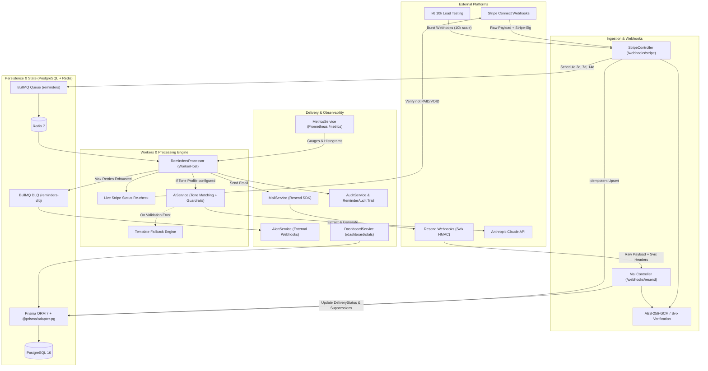
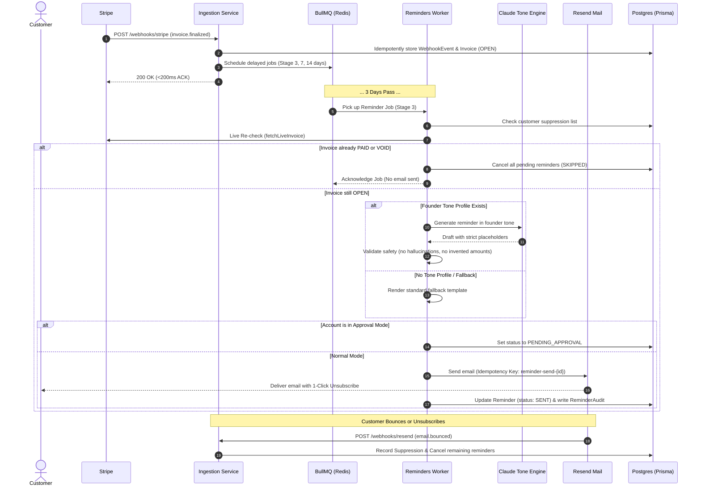

# Invoice Chaser

> **High-throughput, AI-powered invoice collection and automated reminder system built with NestJS, BullMQ, Redis, PostgreSQL (Prisma 7), Stripe Connect, Anthropic Claude, and Resend.**

---

## Executive Overview

**Invoice Chaser** automates the entire late-invoice collection lifecycle for founders and finance teams:
1. **Real-time Ingestion**: Securely ingests Stripe Connect invoice events (`invoice.finalized`, `invoice.paid`, `invoice.voided`, `invoice.marked_uncollectible`) with strict idempotency and out-of-order handling.
2. **Deterministic 3-Stage Lifecycle**: Schedules staggered overdue reminders (+3 days, +7 days, +14 days) via BullMQ delayed jobs.
3. **Never-Trust-Local-DB Guard**: Live re-checks Stripe invoice status before dispatching each email to guarantee zero reminders are sent for invoices settled seconds prior.
4. **Claude Tone Engine**: Analyzes real founder emails to extract custom tone profiles (formality, greetings, sign-offs, humor, warmth). Generates human-like reminders matching the founder's voice with hallucination and adversarial safety validators.
5. **Resend Delivery and Suppression**: Delivers emails with RFC List-Unsubscribe compliance, tracks delivery webhooks (`delivered`, `bounced`, `complained`), and automatically enforces account-level email suppressions.
6. **Enterprise Observability**: Native Prometheus metrics (`/metrics`), Dead-Letter Queue (DLQ) routing, automated webhook alerts, audit logs, and founder KPI dashboards (`/dashboard/stats`).

---

## Architecture and High-Level Visualization



---

## End-to-End Reminder Lifecycle



---

## Core Features and Technical Highlights

### 1. Robust Stripe Ingestion and Out-of-Order Handling
- **Idempotency**: All incoming events are recorded in `WebhookEvent` by unique `externalId`. Duplicate events return immediate `200 OK` with zero side effects.
- **Out-of-Order Guard**: If an `invoice.paid` event arrives *before* an `invoice.finalized` event (common in network races), the invoice is marked `PAID` immediately. Any subsequent late `invoice.finalized` event is prevented from downgrading the invoice back to `OPEN`.

### 2. Live Stripe Verification (Zero False Reminders)
- Local databases can lag behind payments made via checkout links. Before sending any email, `RemindersProcessor` executes `StripeService.fetchLiveInvoice`.
- If paid, all remaining scheduled stages (e.g. stage 7, stage 14) are instantly purged and cancelled.

### 3. Claude Tone Engine and Adversarial Safety Validator
- **Extract Tone Profile**: `POST /tone/profile/rebuild` extracts formality, greetings, sign-offs, humor, warmth, and key phrases from 3-5 sample founder emails.
- **Safety and Anti-Hallucination Suite**:
  - Rejects drafts inventing raw numbers, dates, surcharges, or currencies.
  - Rejects legal threats, suspension warnings, or aggressive debt collection language.
  - Requires explicit placeholders: `{{amount}}`, `{{due_date}}`, `{{pay_link}}`, `{{sender_name}}`.
  - Automatic 1-retry with validator feedback; gracefully falls back to deterministic HTML templates upon repeated failure.

### 4. CAN-SPAM / GDPR / RFC 8058 Compliance
- Every outgoing email includes signed HMAC-SHA256 `List-Unsubscribe` headers and one-click unsubscribe links.
- Address suppressions (`unsubscribed`, `bounced`, `complained`) cascade across all pending reminders for that account.

### 5. High-Throughput Load Testing and Synthetic Engine
- Tested under **10,000 invoices** using k6 (`test/load/webhook-storm.k6.js`).
- Sub-200ms p95 webhook acknowledgement times.
- Synthetic load test harness (`in_loadtest_*` prefixes or `STRIPE_SECRET_KEY=sk_test_mock`) bypasses external Stripe sandbox rate limits during benchmarks.
- Invariant verification script (`test/load/verify-invariants.ts`) verifies zero out-of-order status downgrades and zero duplicate reminders.

---

## Project Structure

```
invoice-chaser2/
├── src/
│   ├── ai/                      # Claude Tone Engine
│   │   ├── interfaces/          # ToneProfile & Placeholder definitions
│   │   ├── prompts/             # System prompts for extraction & generation
│   │   ├── validators/          # Adversarial safety & hallucination suite
│   │   ├── ai.module.ts
│   │   └── ai.service.ts
│   ├── common/crypto/           # AES-256-GCM encryption & HMAC verification
│   ├── dashboard/               # Founder KPI endpoints & revenue recovery stats
│   ├── invoices/                # Invoice synchronization & lifecycle state machine
│   ├── mail/                    # Resend mailer, Svix webhooks & email templates
│   ├── observability/           # Prometheus metrics, Alerting & Audit service
│   ├── prisma/                  # PrismaClient with @prisma/adapter-pg driver
│   ├── reminders/               # BullMQ worker, delayed scheduling & DLQ management
│   ├── settings/                # Account configuration & approval mode toggles
│   ├── stripe/                  # Stripe Connect OAuth & webhook handling
│   ├── tone/                    # Tone sample storage & preview endpoints
│   ├── app.module.ts            # Root application module
│   └── main.ts                  # NestJS bootstrap entrypoint
├── prisma/
│   ├── migrations/              # PostgreSQL schema migrations
│   └── schema.prisma            # Prisma ORM 7 database schema
├── test/
│   ├── load/
│   │   ├── webhook-storm.k6.js  # 10k-invoice k6 load test suite
│   │   └── verify-invariants.ts # Post-test invariant verification script
│   └── jest-e2e.json            # End-to-end test runner config
├── docker-compose.yml           # Local PostgreSQL 16 & Redis 7 services
├── Dockerfile                   # Multi-stage production container build
├── pnpm-workspace.yaml          # pnpm v11 script authorizations
├── prisma7.config.ts            # Prisma 7 environment and datasource config
└── package.json                 # Project scripts and dependencies
```

---

## Tech Stack

| Layer | Technology |
|---|---|
| **Framework** | NestJS 12 (TypeScript, Express, Fast boot) |
| **Database** | PostgreSQL 16 via Prisma ORM 7 (`@prisma/adapter-pg`) |
| **Queues & Scheduling** | BullMQ 6 + Redis 7 (Delayed jobs, DLQ, Concurrency control) |
| **Payments Ingestion** | Stripe Connect (OAuth 2.0, Webhooks, Live API) |
| **Email Delivery** | Resend API + Svix Webhook Verification |
| **AI Tone Engine** | Anthropic Claude SDK (`@anthropic-ai/sdk`) |
| **Observability** | Prometheus (`prom-client`), Pino logger (`nestjs-pino`) |
| **Load Testing** | Grafana k6 + Node.js invariant verifier |
| **Package Manager** | pnpm v11 |

---

## Getting Started

### Prerequisites
- **Node.js**: `v20.19.0` or higher
- **pnpm**: `v11.x`
- **Docker & Docker Compose** (for PostgreSQL and Redis) or **DBngin**

### 1. Clone & Install Dependencies
```powershell
git clone <repository-url>
cd invoice-chaser2
pnpm install
```

### 2. Configure Environment Variables
Copy `.env.example` to `.env` (or configure your existing `.env`):
```env
PORT=3000
APP_URL=http://localhost:3000
NODE_ENV=development

# Database & Redis
DATABASE_URL="postgresql://postgres@localhost:5432/invoice_chaser?schema=public"
REDIS_HOST=localhost
REDIS_PORT=6379

# Encryption (32-byte / 64 hex characters for AES-256-GCM)
ENCRYPTION_KEY=d048ce03385db6a1a82324a203bb06009bc7f7ad1b6819f34821f921ea020266

# Stripe Credentials
STRIPE_SECRET_KEY=sk_test_replace_me
STRIPE_CLIENT_ID=ca_replace_me
STRIPE_WEBHOOK_SECRET=whsec_replace_me

# Resend Mail Credentials
RESEND_API_KEY=re_replace_me
RESEND_FROM_DOMAIN=onboarding@resend.dev
RESEND_WEBHOOK_SECRET=whsec_replace_me

# Anthropic Claude API Key
ANTHROPIC_API_KEY=sk-ant-replace_me
ANTHROPIC_MODEL=claude-3-5-sonnet-latest
```

> **Mock Mode Tip**: Leaving `ANTHROPIC_API_KEY=sk-ant-mock`, `STRIPE_SECRET_KEY=sk_test_mock`, or `RESEND_API_KEY=re_mock` enables deterministic local mocks for zero-cost testing.

### 3. Spin Up Infrastructure
```powershell
docker compose up -d
```

### 4. Run Database Migrations
```powershell
pnpm prisma db push
# or
pnpm prisma migrate dev
```

### 5. Start the Application
```powershell
# Development mode with hot-reload
pnpm start:dev

# Production build
pnpm build
pnpm start:prod
```

---

## Testing and Verification

### Unit and Adversarial Tests
```powershell
pnpm test
pnpm test:watch
```

### 10k Webhook Storm Load Test (k6)
Run the 10,000 invoice burst ingestion, idempotency replay storm, and out-of-order payment race scenarios:
```powershell
k6 run test/load/webhook-storm.k6.js
```

### Invariant Verification
Validate zero out-of-order status downgrades and zero invalid reminders after load tests:
```powershell
pnpm exec ts-node test/load/verify-invariants.ts
```

---

## API and Observability Endpoints

| Method | Endpoint | Description |
|---|---|---|
| `POST` | `/webhooks/stripe` | Ingests signed Stripe Connect invoice events |
| `POST` | `/webhooks/resend` | Handles Svix-verified email delivery, bounce, and complaint events |
| `GET` | `/connect/stripe` | Initiates OAuth flow to link founder's Stripe account |
| `GET` | `/connect/stripe/callback` | OAuth redirect handler storing encrypted credentials |
| `GET` | `/dashboard/stats?accountId=:id` | Overdue vs. recovered revenue & stage breakdown |
| `GET` | `/metrics` | Prometheus metrics scrape target |
| `GET` | `/observability/dlq` | Inspect failed jobs routed to the Dead-Letter Queue |
| `GET` | `/observability/audits?accountId=:id&invoiceId=:id` | Audit trail for every event in an invoice's lifecycle |
| `PUT` | `/tone/samples` | Saves 3-5 sample emails for tone extraction |
| `POST` | `/tone/profile/rebuild` | Extracts structured ToneProfile via Claude |
| `POST` | `/tone/preview` | Generates a preview reminder email |
| `GET` | `/unsubscribe/:token` | One-click unsubscribe endpoint enforcing suppression |

---

## Security Best Practices
- **AES-256-GCM Token Encryption**: Stripe OAuth access tokens are encrypted at rest.
- **HMAC Signatures**: OAuth state parameters and Unsubscribe tokens are cryptographically signed to defeat CSRF and token tampering.
- **Webhook Signature Verification**: Strict constant-time HMAC verification on all Stripe (`stripe-signature`) and Resend (`svix-signature`) payloads.
- **Strict Dep Builds**: Enforces authorized script builds via `pnpm-workspace.yaml`.

---

## License
UNLICENSED. Private application.
